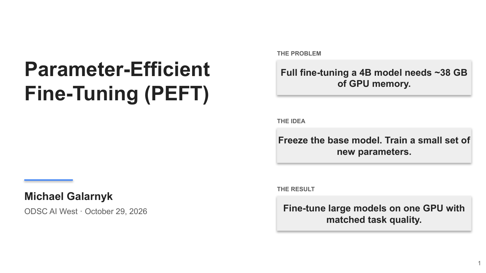
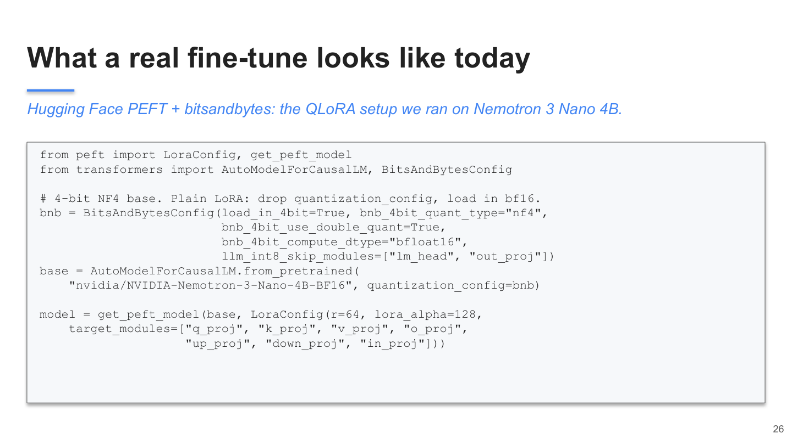
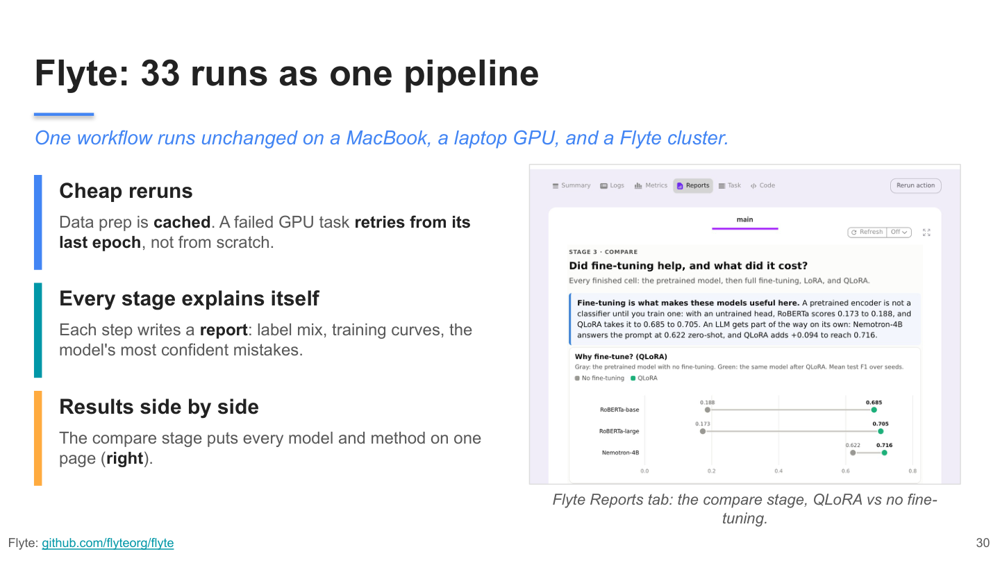
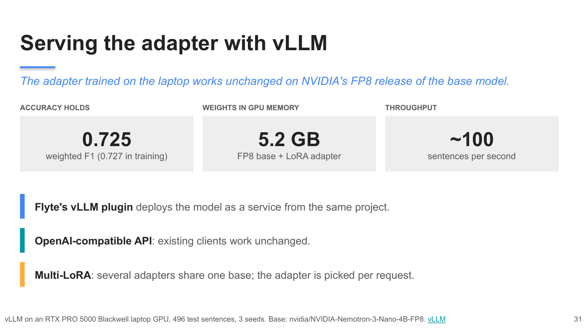

# Parameter-Efficient LLM Fine-Tuning in Practice: LoRA, QLoRA, Flyte, and vLLM

This is the code and slides for an ODSC AI West session. The [ODSC blog post](https://opendatascience.com/lora-qlora-fine-tuning-flyte-vllm/) is a short preview of it.

**Slides:** [PowerPoint](slides/presentation_peft_talk.pptx) · [PDF](slides/presentation_peft_talk.pdf)

## Abstract

Full fine-tuning a modern LLM is a memory problem before it is a modeling problem. Even a small model like NVIDIA Nemotron 3 Nano 4B needs about 38 GB to fully fine-tune in bf16, which does not fit on a 24 GB laptop GPU. The weights themselves are only 7.5 GB; the gradients and optimizer state are what push training past 30 GB, before a single activation.

This session covers how parameter-efficient fine-tuning closes that gap. [LoRA](https://arxiv.org/abs/2106.09685) freezes the original weights and trains two small low-rank matrices instead. [QLoRA](https://arxiv.org/abs/2305.14314) goes further and stores the frozen weights in 4-bit NF4. On one laptop GPU, the Nemotron LoRA fine-tune peaked at 9.0 GB and the QLoRA fine-tune at 5.4 GB.

The running example is a financial markets task from [Trillion Dollar Words](https://aclanthology.org/2023.acl-long.368/): label sentences from the Federal Reserve's rate-setting committee (the FOMC) as hawkish (leaning toward raising rates), dovish (leaning toward cutting them), or neutral. No finance background is needed. We compare the paper's RoBERTa models with Nemotron 3 Nano 4B across full fine-tuning, LoRA, and QLoRA, run all 33 experiments as one [Flyte 2](https://github.com/flyteorg/flyte) pipeline, and serve the result with [vLLM](https://github.com/vllm-project/vllm).


## Agenda

* **Why full fine-tuning doesn't fit:** where training memory goes (parameters, gradients, optimizer state, activations).
* **LoRA:** freeze the model and train two small matrices, then merge them back so inference is just as fast.
* **QLoRA:** keep the frozen base in 4-bit NF4 so a 4B model trains in 5.4 GB.
* **Does the fine-tune actually help?** RoBERTa vs Nemotron on the FOMC task, with and without fine-tuning.
* **In practice:** running 33 experiments as one Flyte pipeline, and serving the fine-tuned model with vLLM.

<table>
  <tr>
    <td width="50%" valign="top">
      <a href="./slides/presentation_peft_talk.pdf"></a><br>
      <b>0. <a href="./slides/presentation_peft_talk.pdf">Slides</a></b><br><sub><a href="./slides/presentation_peft_talk.pdf">PDF</a> · <a href="./slides/presentation_peft_talk.pptx">PowerPoint</a></sub>
      <p>The talk deck: why full fine-tuning runs out of memory, how LoRA and QLoRA fix it, and the results. Every run in the talk was trained on one laptop: a Dell Pro Max 16 Plus with an NVIDIA RTX PRO 5000 Blackwell laptop GPU (24 GB of VRAM), an Intel Core Ultra 9 285HX (24 cores), and 128 GB of RAM, running Linux under WSL2.</p>
    </td>
    <td width="50%" valign="top">
      <a href="#installation"></a><br>
      <b>1. <a href="#installation">Setup</a></b>
      <p>Install the packages with uv, download the paper's data splits, and (for Nemotron) build the fused Mamba kernels.</p>
    </td>
  </tr>
  <tr>
    <td width="50%" valign="top">
      <a href="./fomc_roberta_finetune.ipynb"></a><br>
      <b>2. <a href="./fomc_roberta_finetune.ipynb">The notebook: a tour of the results</a></b>
      <p>Start here. It walks through the task and the results of all 33 runs, which are saved in the repo, so nothing long reruns. It also fine-tunes one small model live (about 1.5 minutes on a GPU) so you see training happen, and labels sentences you write.</p>
    </td>
    <td width="50%" valign="top">
      <a href="./train_run.py"></a><br>
      <b>3. <a href="./train_run.py">How each run was trained</a></b><br><sub><a href="#plain-python-scripts">Commands</a></sub>
      <p>The training code behind the results. One script trains any of the three models with full fine-tuning, LoRA, or QLoRA, or scores it with no fine-tuning. Open this to see how LoRA and QLoRA are set up, or to rerun a single result.</p>
    </td>
  </tr>
  <tr>
    <td width="50%" valign="top">
      <a href="./workflow.py"></a><br>
      <b>4. <a href="./workflow.py">Running all 33 with Flyte</a></b><br><sub><a href="#the-flyte-pipeline">How to run it</a></sub>
      <p>Why it is here: 33 training runs by hand turn into a pile of scripts. One Flyte pipeline runs them all, skips runs that already finished, retries a failed run from its last epoch, and gives each step a report in a web UI (the charts on the slide). Open this to rerun the whole experiment or to see how Flyte reports are made.</p>
    </td>
    <td width="50%" valign="top">
      <a href="./serve_vllm.py"></a><br>
      <b>5. <a href="./serve_vllm.py">Using the model in an app (vLLM)</a></b><br><sub><a href="#serving-with-vllm">How to run it</a></sub>
      <p>Why it is here: after training, the model has to answer requests. vLLM serves it behind the same API as OpenAI, so existing code can call it. The adapter trained on the laptop also runs on NVIDIA's smaller FP8 version of Nemotron: F1 0.725, 5.2 GB of GPU memory, about 100 sentences per second.</p>
    </td>
  </tr>
</table>

## Results

Weighted F1 on the paper's Combined-S test split (0 to 1, higher is better), averaged over the paper's three seeds. Peak memory is during training. All runs were on a Dell Pro Max 16 Plus laptop (NVIDIA RTX PRO 5000 Blackwell, 24 GB, WSL2).

| Model | No fine-tuning | Full | LoRA | QLoRA |
|-------|----------------|------|------|-------|
| RoBERTa-base (125M) | 0.188 | 0.667 | 0.684 | 0.685 |
| RoBERTa-large (355M) | 0.173 | 0.716 | 0.720 | 0.705 |
| Nemotron 3 Nano 4B | 0.622 | does not fit (~38 GB) | **0.727** (9.0 GB) | 0.716 (5.4 GB) |

For reference, the paper's full fine-tunes scored 0.698 (RoBERTa-base) and 0.711 (RoBERTa-large). RoBERTa scores near zero without fine-tuning because its classification layer starts out untrained; Nemotron already scores 0.622 from a prompt alone.

## Installation

Training needs an NVIDIA GPU with CUDA for QLoRA and for Nemotron. QLoRA uses [bitsandbytes](https://github.com/bitsandbytes-foundation/bitsandbytes) 4-bit quantization, and Nemotron's Mamba layers need CUDA kernels. On a Mac (Apple Silicon, MPS) you can still run RoBERTa full fine-tuning and LoRA.

1. Get the repo into `~/projects` and go into this folder. On Windows, run this and every other command in the Ubuntu (WSL) terminal. Every command in this README starts with `cd ~/projects/Python_Tutorials/NLP/Fine_Tuning/fomc_peft`, so it works from any folder:

   ```
   mkdir -p ~/projects && cd ~/projects
   git clone https://github.com/mGalarnyk/Python_Tutorials.git
   cd ~/projects/Python_Tutorials/NLP/Fine_Tuning/fomc_peft
   ```

2. Install [uv](https://github.com/astral-sh/uv) if you don't have it (`curl -LsSf https://astral.sh/uv/install.sh | sh`), then create the environment:

   ```
   cd ~/projects/Python_Tutorials/NLP/Fine_Tuning/fomc_peft
   uv venv .venv --python 3.11
   source .venv/bin/activate
   uv pip install -r requirements.txt
   uv pip install jupyterlab   # for the notebook
   ```

3. Download the paper's data splits into `data/` (gitignored):

   ```
   cd ~/projects/Python_Tutorials/NLP/Fine_Tuning/fomc_peft
   source .venv/bin/activate
   python load_data.py
   ```

4. Nemotron only: install mamba-ssm and build the fused Mamba kernels. Without them every Mamba block falls back to a slow PyTorch loop (about 30 vs 6.5 minutes per epoch on the laptop GPU). `run_fomc.sh nemotron-lora` does this once and then trains one Nemotron LoRA seed:

   ```
   cd ~/projects/Python_Tutorials/NLP/Fine_Tuning/fomc_peft
   source .venv/bin/activate
   bash run_fomc.sh nemotron-lora
   ```

   To build the kernels without training, run `CUDA_ARCHS="12.0" bash build_mamba_kernels.sh` (12.0 is Blackwell; use `"9.0;12.0"` to add Hopper).

## Running the notebook

```
cd ~/projects/Python_Tutorials/NLP/Fine_Tuning/fomc_peft
source .venv/bin/activate
jupyter lab fomc_roberta_finetune.ipynb
```

Training cells skip any run that already has a `metrics.json`, and an interrupted run resumes from its last checkpoint. Set `FORCE = True` to start over.

## Running the code

There are two ways to train. Both use the same training code on your GPU.

1. **[Plain Python scripts](#plain-python-scripts)**: no Flyte. Progress prints in the terminal.
2. **[The Flyte pipeline](#the-flyte-pipeline)** (`workflow.py`): the same training, run as Flyte tasks. Flyte adds caching, retries, and a **report for every task**: a live training curve while a model trains, the comparison charts across all runs, and the release decision. You can run the pipeline two ways:
   - **In your terminal** (`flyte run --local`): it trains, but you only see printed output, not the reports.
   - **On a Flyte server on your laptop** (a devbox): it runs the same tasks, and you see every step and its report in your browser at http://localhost:30080/v2. This is what the talk shows.

### Plain Python scripts

```
cd ~/projects/Python_Tutorials/NLP/Fine_Tuning/fomc_peft
source .venv/bin/activate

# One run (about an hour per Nemotron seed on the laptop GPU)
python train_run.py --model nemotron-nano-4b --method qlora --seed 5768
python train_run.py --model nemotron-nano-4b --method lora --seed 5768
python train_run.py --model nemotron-nano-4b --method zeroshot --seed 5768

# RoBERTa grid: base + large, full / LoRA / QLoRA, three seeds
python run_grid.py --no-flyte --models roberta-base,roberta-large --methods full,lora,qlora \
    --seeds 5768,78516,944601 --include-qlora --include-large-full
```

Each run writes `checkpoints/<model>__<method>__lab-manual-split-combine__seed<seed>__<recipe>/` with `metrics.json` (test scores and `peak_mem_gb`), `test_predictions.jsonl`, `progress.jsonl` (one line per step and eval), and the trained weights or adapter in `final/`. `outputs/grid_summary.csv` has the 3-seed mean and std for every cell.

Load a finished run and classify new sentences:

```python
# Start Python from ~/projects/Python_Tutorials/NLP/Fine_Tuning/fomc_peft with .venv active.
from train_run import load_trained, predict_texts

model, tokenizer = load_trained("checkpoints/roberta-base__lora__lab-manual-split-combine__seed5768__paper")
predict_texts(model, tokenizer, ["The Committee decided to lower the target range."])
```

### The Flyte pipeline

The pipeline's main tasks, each with its own report:

| Task | What it does | Its report |
|------|--------------|------------|
| `prepare_data` | Downloads the data splits (cached after the first run) | The label mix |
| `train_one` | Trains one model / method / seed on the GPU | A training curve, redrawn after every epoch |
| `grid` | Runs `train_one` for many models, methods, and seeds | One report per training run, grouped by model |
| `main` | Compares all finished runs. Does not train | The "Why fine-tune?" charts from the talk |
| `release` | Waits for a person to approve, then merges the adapter for vLLM | The evidence for the decision |

#### In your terminal

Trains on your GPU. You see printed output; the reports are written but there is nowhere to view them.

```
cd ~/projects/Python_Tutorials/NLP/Fine_Tuning/fomc_peft
source .venv/bin/activate
flyte run --local workflow.py train_one --model_key roberta-base --method lora --seed 5768
flyte run --local workflow.py release    # asks y/n in the terminal
```

#### On a devbox, with the reports in your browser

Open Docker Desktop (with Settings > Resources > WSL integration turned on), then run this in the Ubuntu (WSL) terminal:

```
bash ~/projects/Python_Tutorials/NLP/Fine_Tuning/fomc_peft/show_reports.sh
```

It starts a Flyte devbox (or reuses the one already running), waits until it is ready, and runs the comparison report. That takes about a minute, or about two the first time. Open the link it prints and click **Reports**. When you are done: `flyte stop devbox`.

To train on the GPU on the devbox and watch the training curve instead (not yet tested on the laptop; the first run builds a large image), run these after `show_reports.sh` has started the devbox once:

```
cd ~/projects/Python_Tutorials/NLP/Fine_Tuning/fomc_peft
source .venv/bin/activate
# Restart the devbox with the GPU, and let GPU tasks use it
flyte stop devbox && docker rm -f flyte-devbox && flyte start devbox --gpu
docker cp devbox/wsl-gpu-podtemplate.yaml flyte-devbox:/tmp/
docker exec flyte-devbox kubectl apply -f /tmp/wsl-gpu-podtemplate.yaml

# Train one model; its Training tab redraws after every epoch
FLYTE_WSL_GPU=1 flyte -c .flyte/devbox.yaml run --copy-style all workflow.py train_one \
    --model_key roberta-base --method lora --seed 5768
```

## Serving with vLLM

vLLM pins its own torch, so it gets its own environment:

```
cd ~/projects/Python_Tutorials/NLP/Fine_Tuning/fomc_peft
# --managed-python: vLLM compiles small C helpers and needs Python.h.
uv venv .venv-vllm --python 3.12 --managed-python
VIRTUAL_ENV=.venv-vllm uv pip install vllm peft pandas openpyxl scikit-learn
VIRTUAL_ENV=.venv-vllm uv pip install "flashinfer-jit-cache==$(.venv-vllm/bin/python -c 'import flashinfer; print(flashinfer.__version__)')" \
  --extra-index-url https://flashinfer.ai/whl/cu130
```

Merge the adapter, check that vLLM gives the same F1 as PyTorch, then serve:

```
cd ~/projects/Python_Tutorials/NLP/Fine_Tuning/fomc_peft
.venv/bin/python serve_vllm.py merge --method lora --seed 5768             # -> checkpoints/<run>/merged
.venv-vllm/bin/python serve_vllm.py eval --method lora --seed 5768         # test F1 + sentences/s
.venv-vllm/bin/vllm serve checkpoints/<run>/merged --served-model-name fomc-nemotron --max-model-len 512
```

The classifier scores three label tokens at the last prompt token, so vLLM generates one token restricted to those ids (`allowed_token_ids`): same prompt, same prediction.

The FP8 numbers come from `bench_inference.py`:

```
cd ~/projects/Python_Tutorials/NLP/Fine_Tuning/fomc_peft
.venv-vllm/bin/python bench_inference.py nemotron --method lora --variant lora-fp8 --seed 5768
```

On Flyte, `merge_adapter` is a GPU task and `vllm_app` (in `flyte_env.py`) is a [`VLLMAppEnvironment`](https://www.union.ai/docs/v2/flyte/user-guide/apps/native-app-integrations/vllm-app/) that serves its output:

```
cd ~/projects/Python_Tutorials/NLP/Fine_Tuning/fomc_peft
source .venv/bin/activate
flyte run workflow.py merge_adapter --method lora --seed 5768
flyte deploy workflow.py vllm_app
```

## What's in this folder

```
fomc_roberta_finetune.ipynb   notebook (tutorial walkthrough)
slides/                       talk deck (PowerPoint + PDF)
workflow.py                   Flyte 2 pipeline (tasks, reports, release gate)
flyte_env.py                  Flyte task environments: CPU, GPU, UI images, vLLM app
train_run.py                  one run: full / LoRA / QLoRA / zero-shot
paper_loop.py                 the paper's training loop, ported
causal_cls.py                 Nemotron as a classifier (label-token logits)
fomc_prompt.py                prompt that wraps a sentence for Nemotron
load_data.py                  downloads the paper's train/test splits
config.py                     models, seeds, hyperparameters, run paths
device_utils.py               CUDA / MPS / CPU detection, memory helpers
paper_baselines.py            the paper's published numbers
run_grid.py                   runs many cells, writes outputs/grid_*.csv
run_parallel.py               one process per GPU for unfinished cells (multi-GPU nodes)
run_fomc.sh                   shell entry point (sets up Mamba kernels)
show_reports.sh               starts a Flyte devbox and runs the comparison report
build_mamba_kernels.sh        builds causal-conv1d (fast Nemotron training)
patch_mamba_ssm.py            makes mamba-ssm importable without its CUDA build
report_stages.py              HTML report for each pipeline stage
report_viz.py                 inline-SVG charts used by the reports
report_helpers.py             loads results, writes report_snapshot.py
report_snapshot.py            auto-generated: finished runs, bundled for Flyte
serve_vllm.py                 merge adapter + score the test set with vLLM
bench_inference.py            inference benchmark (F1, sentences/s, latency, memory)
devbox/                       PodTemplate that gives the Flyte devbox the WSL GPU
images/                       talk slides (images/slides/) and blog figures used by the notebook and this README
```

Not in git: `checkpoints/` (about 50 GB), `outputs/`, `logs/`, `data/`, `.flyte/`, and the two virtual environments. The commands above regenerate them.

## Data and license

The data is from [gtfintechlab/fomc-hawkish-dovish](https://github.com/gtfintechlab/fomc-hawkish-dovish) and is licensed CC BY-NC 4.0.
