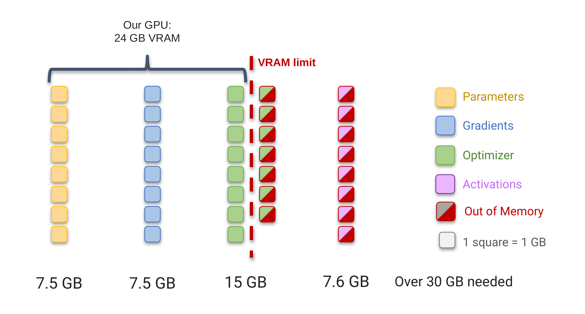
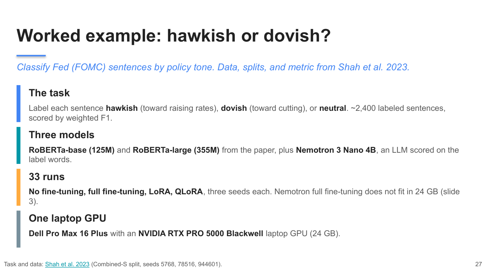
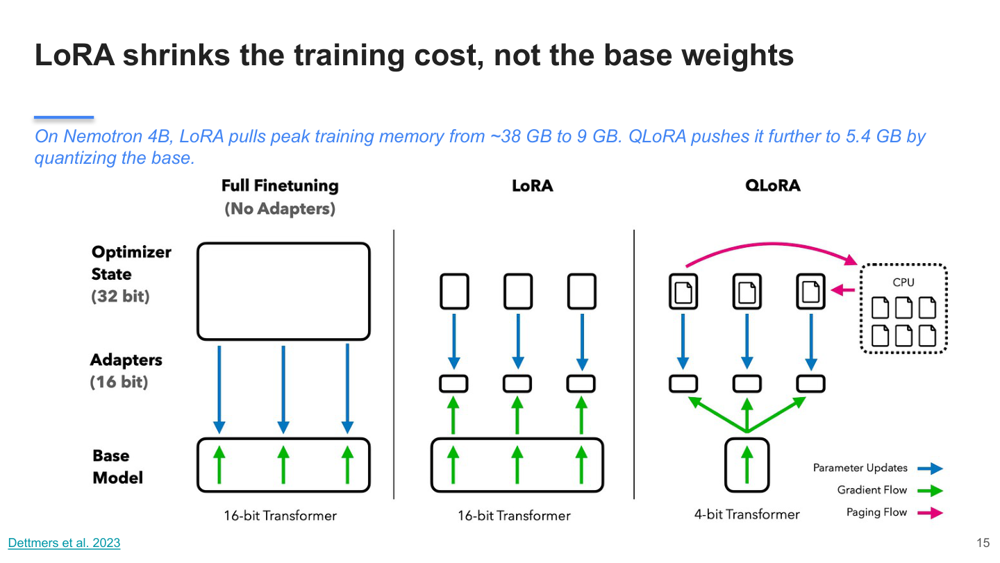
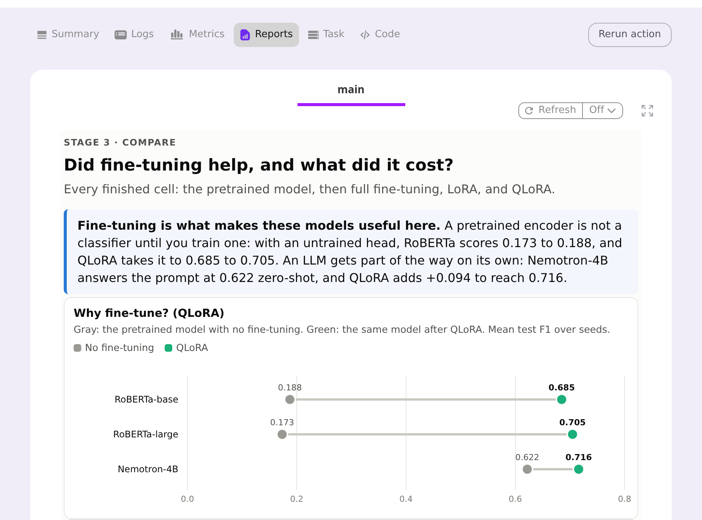

# Parameter-Efficient LLM Fine-Tuning in Practice: LoRA, QLoRA, Flyte, and vLLM

This is the code and slides for an ODSC AI West session. The [ODSC blog post](https://opendatascience.com/lora-qlora-fine-tuning-flyte-vllm/) is a short preview of it.

**Slides:** [PowerPoint](slides/presentation_peft_talk.pptx) · [PDF](slides/presentation_peft_talk.pdf)

## Abstract

Full fine-tuning a modern LLM is a memory problem before it is a modeling problem. Even a small model like NVIDIA Nemotron 3 Nano 4B needs about 38 GB to fully fine-tune in bf16, which does not fit on a 24 GB laptop GPU. The weights themselves are only 7.5 GB; the gradients and optimizer state are what push training past 30 GB, before a single activation.

This session covers how parameter-efficient fine-tuning closes that gap. [LoRA](https://arxiv.org/abs/2106.09685) freezes the original weights and trains two small low-rank matrices instead. [QLoRA](https://arxiv.org/abs/2305.14314) goes further and stores the frozen weights in 4-bit NF4. On one laptop GPU, the Nemotron LoRA fine-tune peaked at 9.0 GB and the QLoRA fine-tune at 5.4 GB.

The running example is a financial markets task from [Trillion Dollar Words](https://aclanthology.org/2023.acl-long.368/): label sentences from the Federal Reserve's rate-setting committee (the FOMC) as hawkish (leaning toward raising rates), dovish (leaning toward cutting them), or neutral. No finance background is needed. We compare the paper's RoBERTa models with Nemotron 3 Nano 4B across full fine-tuning, LoRA, and QLoRA, run all 33 experiments as one [Flyte 2](https://github.com/flyteorg/flyte) pipeline, and serve the result with [vLLM](https://github.com/vllm-project/vllm).



## Agenda

* **Why full fine-tuning doesn't fit:** where training memory goes (parameters, gradients, optimizer state, activations).
* **LoRA:** freeze the model and train two small matrices, then merge them back so inference is just as fast.
* **QLoRA:** keep the frozen base in 4-bit NF4 so a 4B model trains in 5.4 GB.
* **Does the fine-tune actually help?** RoBERTa vs Nemotron on the FOMC task, with and without fine-tuning.
* **In practice:** running 33 experiments as one Flyte pipeline, and serving the fine-tuned model with vLLM.

<p><b>0. <a href="#installation">Setup</a>:</b> install the packages, download the data, and (for Nemotron) build the fused Mamba kernels.</p>

<table>
  <tr>
    <td width="50%" valign="top">
      <a href="./fomc_roberta_finetune.ipynb"></a><br>
      <b>1. <a href="./fomc_roberta_finetune.ipynb">The task and the notebook</a></b>
      <p>Load the paper's train and test splits, train the comparison grid, and classify new sentences with a finished checkpoint. Start here.</p>
    </td>
    <td width="50%" valign="top">
      <a href="./train_run.py"></a><br>
      <b>2. <a href="./train_run.py">Full fine-tuning vs LoRA vs QLoRA</a></b>
      <p>One training script for all three methods plus a no-fine-tuning baseline. Nemotron is scored as a classifier on the logits of three label words (<a href="./causal_cls.py">causal_cls.py</a>).</p>
    </td>
  </tr>
  <tr>
    <td width="50%" valign="top">
      <a href="./workflow.py"></a><br>
      <b>3. <a href="./workflow.py">One Flyte pipeline for 33 runs</a></b><br><sub><a href="#running-the-flyte-pipeline">How to run it</a></sub>
      <p>Data prep is cached, a GPU task that fails retries from its last epoch, and every stage writes its own report, from the label mix to live training curves. A release step waits for approval before merging the adapter.</p>
    </td>
    <td width="50%" valign="top">
      <a href="./serve_vllm.py"></a><br>
      <b>4. <a href="./serve_vllm.py">Serving with vLLM</a></b><br><sub><a href="#serving-with-vllm">How to run it</a></sub>
      <p>Merge the adapter into the base model and serve it behind an OpenAI-compatible API. The LoRA adapter trained on the laptop also works on NVIDIA's FP8 Nemotron: F1 0.725, 5.2 GB of weights, about 100 sentences per second (<a href="./bench_inference.py">bench_inference.py</a>).</p>
    </td>
  </tr>
</table>

## Results

Weighted F1 on the paper's Combined-S test split (0 to 1, higher is better), averaged over the paper's three seeds. Peak memory is during training. All runs were on a Dell Pro Max 16 Plus laptop (NVIDIA RTX PRO 5000 Blackwell, 24 GB, WSL2).

| Model | No fine-tuning | Full | LoRA | QLoRA |
|-------|----------------|------|------|-------|
| RoBERTa-base (125M) | 0.188 | 0.667 | 0.684 | 0.685 |
| RoBERTa-large (355M) | 0.173 | 0.716 | 0.720 | 0.705 |
| Nemotron 3 Nano 4B | 0.622 | does not fit (~38 GB) | **0.727** (9.0 GB) | 0.716 (5.4 GB) |

For reference, the paper's full fine-tunes scored 0.698 (RoBERTa-base) and 0.711 (RoBERTa-large). RoBERTa scores near zero without fine-tuning because its classification layer starts out untrained; Nemotron already scores 0.622 from a prompt alone.

## Installation

Training needs an NVIDIA GPU with CUDA for QLoRA and for Nemotron. QLoRA uses [bitsandbytes](https://github.com/bitsandbytes-foundation/bitsandbytes) 4-bit quantization, and Nemotron's Mamba layers need CUDA kernels. On a Mac (Apple Silicon, MPS) you can still run RoBERTa full fine-tuning and LoRA.

1. Get the repo and go into this folder. Every command below runs from here:

   ```
   git clone https://github.com/mGalarnyk/Python_Tutorials.git
   cd Python_Tutorials/NLP/Fine_Tuning/fomc_peft
   ```

2. Install [uv](https://github.com/astral-sh/uv) if you don't have it (`curl -LsSf https://astral.sh/uv/install.sh | sh`), then create the environment:

   ```
   uv venv .venv --python 3.11
   source .venv/bin/activate
   uv pip install -r requirements.txt
   uv pip install jupyterlab   # for the notebook
   ```

3. Download the paper's data splits into `data/` (gitignored):

   ```
   python load_data.py
   ```

4. Nemotron only: install mamba-ssm and build the fused Mamba kernels. Without them every Mamba block falls back to a slow PyTorch loop (about 30 vs 6.5 minutes per epoch on the laptop GPU). `run_fomc.sh nemotron-lora` does this once and then trains one Nemotron LoRA seed:

   ```
   bash run_fomc.sh nemotron-lora
   ```

   To build the kernels without training, run `CUDA_ARCHS="12.0" bash build_mamba_kernels.sh` (12.0 is Blackwell; use `"9.0;12.0"` to add Hopper).

## Running the notebook

```
jupyter lab fomc_roberta_finetune.ipynb
```

Training cells skip any run that already has a `metrics.json`, and an interrupted run resumes from its last checkpoint. Set `FORCE = True` to start over.

## Running from the command line

```
# One run (about an hour per Nemotron seed on the laptop GPU)
python train_run.py --model nemotron-nano-4b --method qlora --seed 5768
python train_run.py --model nemotron-nano-4b --method lora --seed 5768
python train_run.py --model nemotron-nano-4b --method zeroshot --seed 5768

# RoBERTa grid: base + large, full / LoRA / QLoRA, three seeds
python run_grid.py --models roberta-base,roberta-large --methods full,lora,qlora \
    --seeds 5768,78516,944601 --include-qlora --include-large-full
```

Each run writes `checkpoints/<model>__<method>__lab-manual-split-combine__seed<seed>__<recipe>/` with `metrics.json` (test scores and `peak_mem_gb`), `test_predictions.jsonl`, `progress.jsonl` (one line per step and eval), and the trained weights or adapter in `final/`. `outputs/grid_summary.csv` has the 3-seed mean and std for every cell.

Load a finished run and classify new sentences:

```python
from train_run import load_trained, predict_texts

model, tokenizer = load_trained("checkpoints/roberta-base__lora__lab-manual-split-combine__seed5768__paper")
predict_texts(model, tokenizer, ["The Committee decided to lower the target range."])
```

## Running the Flyte pipeline

The same `workflow.py` runs in-process with `flyte run --local` or on a cluster with `flyte run`. The main tasks:

| Task | What it does |
|------|--------------|
| `prepare_data` | Downloads the splits on CPU (cached) |
| `train_one` | One model / method / seed on GPU, with a live training curve report |
| `grid` | Runs many cells, grouped by model |
| `main` | Builds the comparison report from finished runs (the "Why fine-tune?" charts) |
| `release` | Shows held-out F1 vs the paper and waits for approval before `merge_adapter` |

```
flyte run --local workflow.py train_one --model_key nemotron-nano-4b --method qlora --seed 5768
flyte run --local workflow.py grid --seeds '[5768]' --include_qlora true --include_nemotron
flyte run --local workflow.py release    # y: merge seed 5768 for vLLM, n: stop
```

Locally, `release` asks `[y/n]` in the terminal; on a cluster it is an Approve button in the UI.

To see the reports in the Flyte UI, run on a local devbox (needs Docker). On WSL2, Kubernetes cannot discover the GPU, so GPU tasks use a PodTemplate that mounts it directly:

```
flyte start devbox
docker cp devbox/wsl-gpu-podtemplate.yaml flyte-devbox:/tmp/
docker exec flyte-devbox kubectl apply -f /tmp/wsl-gpu-podtemplate.yaml
mkdir -p .flyte && flyte create config --devbox -o .flyte/devbox.yaml

python -c "from report_helpers import refresh_report_snapshot; refresh_report_snapshot()"
FLYTE_WSL_GPU=1 flyte -c .flyte/devbox.yaml run --copy-style all workflow.py main
```

The UI is at http://localhost:30080/v2. Flyte bundles only git-tracked files, so `git add` new files before a devbox run. On Linux with a regular NVIDIA driver, use `flyte start devbox --gpu` and leave out the PodTemplate and `FLYTE_WSL_GPU`.

## Serving with vLLM

vLLM pins its own torch, so it gets its own environment:

```
# --managed-python: vLLM compiles small C helpers and needs Python.h.
uv venv .venv-vllm --python 3.12 --managed-python
VIRTUAL_ENV=.venv-vllm uv pip install vllm peft pandas openpyxl scikit-learn
VIRTUAL_ENV=.venv-vllm uv pip install "flashinfer-jit-cache==$(.venv-vllm/bin/python -c 'import flashinfer; print(flashinfer.__version__)')" \
  --extra-index-url https://flashinfer.ai/whl/cu130
```

Merge the adapter, check that vLLM gives the same F1 as PyTorch, then serve:

```
.venv/bin/python serve_vllm.py merge --method lora --seed 5768             # -> checkpoints/<run>/merged
.venv-vllm/bin/python serve_vllm.py eval --method lora --seed 5768         # test F1 + sentences/s
.venv-vllm/bin/vllm serve checkpoints/<run>/merged --served-model-name fomc-nemotron --max-model-len 512
```

The classifier scores three label tokens at the last prompt token, so vLLM generates one token restricted to those ids (`allowed_token_ids`): same prompt, same prediction.

The FP8 numbers come from `bench_inference.py`:

```
.venv-vllm/bin/python bench_inference.py nemotron --method lora --variant lora-fp8 --seed 5768
```

On Flyte, `merge_adapter` is a GPU task and `vllm_app` (in `flyte_env.py`) is a [`VLLMAppEnvironment`](https://www.union.ai/docs/v2/flyte/user-guide/apps/native-app-integrations/vllm-app/) that serves its output:

```
flyte run workflow.py merge_adapter --method lora --seed 5768
flyte deploy workflow.py vllm_app
```

## What's in this folder

```
fomc_roberta_finetune.ipynb   notebook (tutorial walkthrough)
slides/                       talk deck (PowerPoint + PDF)
workflow.py                   Flyte 2 pipeline (tasks, reports, release gate)
flyte_env.py                  Flyte task environments: CPU, GPU, UI images, vLLM app
train_run.py                  one run: full / LoRA / QLoRA / zero-shot
paper_loop.py                 the paper's training loop, ported
causal_cls.py                 Nemotron as a classifier (label-token logits)
fomc_prompt.py                prompt that wraps a sentence for Nemotron
load_data.py                  downloads the paper's train/test splits
config.py                     models, seeds, hyperparameters, run paths
device_utils.py               CUDA / MPS / CPU detection, memory helpers
paper_baselines.py            the paper's published numbers
run_grid.py                   runs many cells, writes outputs/grid_*.csv
run_parallel.py               one process per GPU for unfinished cells (multi-GPU nodes)
run_fomc.sh                   shell entry point (sets up Mamba kernels)
build_mamba_kernels.sh        builds causal-conv1d (fast Nemotron training)
patch_mamba_ssm.py            makes mamba-ssm importable without its CUDA build
report_stages.py              HTML report for each pipeline stage
report_viz.py                 inline-SVG charts used by the reports
report_helpers.py             loads results, writes report_snapshot.py
report_snapshot.py            auto-generated: finished runs, bundled for Flyte
serve_vllm.py                 merge adapter + score the test set with vLLM
bench_inference.py            inference benchmark (F1, sentences/s, latency, memory)
devbox/                       PodTemplate that gives the Flyte devbox the WSL GPU
images/                       figures used by the notebook; images/readme/ holds talk slides used in this README
```

Not in git: `checkpoints/` (about 50 GB), `outputs/`, `logs/`, `data/`, `.flyte/`, and the two virtual environments. The commands above regenerate them.

### Where each blog number comes from

| Blog item | Produced by | Data |
|---|---|---|
| Results for all 33 runs | `train_run.py` (Nemotron), `run_grid.py` (RoBERTa) | `checkpoints/*/metrics.json` |
| Nemotron QLoRA 0.716, LoRA 0.727, zero-shot 0.622 | same | `outputs/report_snapshot.json` |
| Peak training memory (5.4 GB QLoRA, 9.0 GB LoRA) | `device_utils.peak_memory_gb` | `metrics.json` (`peak_mem_gb`) |
| Flyte "Why fine-tune?" charts | `workflow.py: main` → `report_stages.grid_report` | devbox run |
| FP8 serving: 0.725, ~100 sentences/s, 5.2 GB | `bench_inference.py nemotron --method lora --variant lora-fp8` | `outputs/inference_bench.jsonl` |

In QLoRA, `lm_head` (which scores the labels) and the Mamba `out_proj` (read by the fused kernel) stay in bf16; see `train_run.py: _replace_linears_with_nf4`.

## Data and license

The data is from [gtfintechlab/fomc-hawkish-dovish](https://github.com/gtfintechlab/fomc-hawkish-dovish) and is licensed CC BY-NC 4.0.
